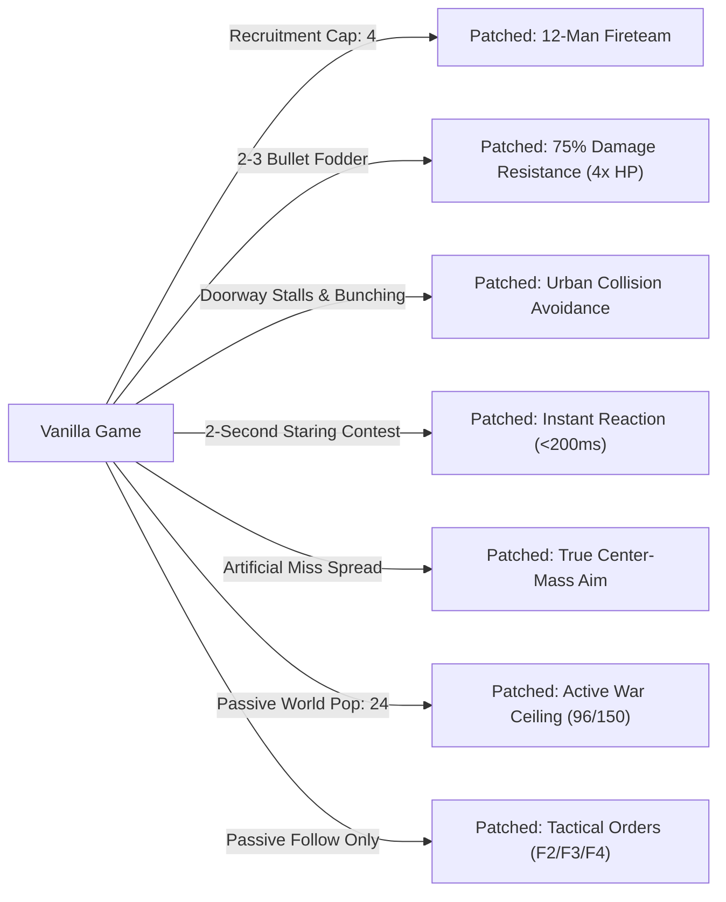

# Homefront: The Revolution — Autonomous Guerrilla & Freedom Fighters Squad Overhaul

[-blue.svg)](#)
[](#)
[-brightgreen.svg)](#master-patch-matrix)
[-orange.svg)](#)
[-blueviolet.svg)](INSTALLATION.md)
[](LICENSE)

Reverse engineering research, documentation, reconstructed C++ headers, and an automated binary patcher for *Homefront: The Revolution* (CryEngine 3.8 x86-64).

Inspired by IO Interactive's classic ***Freedom Fighters* (2003)**, this project transforms single-player campaign companions from fragile, 4-man fodder into an autonomous, lethal **12-member guerrilla fireteam** backed by active open-world military presence, permanent infrastructure hacking, and **tactical squad hotkey commands (F2 Regroup, F3 Attack, F4 Defend)**.

> [!NOTE]
> **Complete Freedom Fighters Squad System (Patches #1–#21, #29A–#29B, #30A–#31D, 31 Patches):**
> 100% stable, fully tested, and verified.
> Includes the complete Freedom Fighters tactical command suite (`F2`, `F3`, `F4`), 12-man recruitment cap, 75% squad damage resistance, zero-hesitation reactions, marksman accuracy, and permanent allied drone/vehicle hacking.
> 
> *Historical note:* The earlier experimental third-person camera suite was retired to avoid engine-level animation/camera clipping frictions, preserving the rock-solid stability and responsiveness of the native first-person guerrilla gameplay.

> **Disclaimer:** No copyrighted game executables, level archives, textures, or media assets are hosted in this repository. All modifications are delivered as mathematical instruction offsets and applied to a legally owned copy of `Homefront2_Release.exe`.

---

## Table of Contents
1. [Key Features & Gameplay Transformation](#key-features--gameplay-transformation)
2. [Freedom Fighters Tactical Squad Commands](#freedom-fighters-tactical-squad-commands)
3. [Target Binary Baseline](#target-binary-baseline)
4. [Installation Guide (Windows / Linux / Steam Deck)](INSTALLATION.md)
5. [Quick Start & Patcher Usage](#quick-start--patcher-usage)
6. [Master Patch Matrix](#master-patch-matrix)
7. [In-Game Combat Verification](#in-game-combat-verification)
8. [Architecture & Reverse Engineering Findings](#architecture--reverse-engineering-findings)
9. [Repository Structure](#repository-structure)
10. [License](#license)

---

## Key Features & Gameplay Transformation



### Complete Overhaul Highlights:
- **Freedom Fighters Tactical Squad Orders (Patches #30A–#30B, #31A–#31D):** Gives the player direct command over their recruited squad in real time using dedicated hotkeys:
  - **`F2` — Regroup / Follow Leader:** Squad immediately disengages from holding ground or forward pushes, re-anchors to Ethan Brady, and forms up dynamically.
  - **`F3` — Attack / Push:** Squad advances 25 meters forward along the player's look vector, aggressive pushing towards the target zone while engaging hostile forces.
  - **`F4` — Defend / Hold Position:** Squad snapshots their current location as a fixed formation anchor, holding ground and providing suppressive crossfire while the player flanks.
- **12-Member Fireteam Recruitment (Patch #10):** Expands the player's single-player companion recruitment limit from 4 to 12. Intrusive circular doubly-linked list accommodates 12 agents with zero memory reallocation.
- **Freedom Fighters Combat Durability (Patch #19):** Grants followers 75% damage resistance (4x effective HP), allowing fighters to survive 12–15 assault rifle rounds rather than dropping instantly.
- **Zero-Hesitation Combat Reaction (Patches #20A–#20C):** Eliminates the artificial 2-second staring delay when AI encounters enemies outside cover; units engage and open fire within 150ms.
- **Precision Guerrilla Marksmanship (Patch #21):** Neutralizes the game's artificial companion aim penalty; followers fire with true center-mass accuracy while retaining natural weapon physics and animation variation.
- **Urban Navigation & Choke Point Queueing (Patches #14 & #15):** Calibrates inter-agent personal space to 0.25m, allowing all 12 followers to stream through narrow 1.2m outpost doors without jamming.
- **Tactical Cover Perimeter (Patches #11, #12 & #13):** Expands formation radius from 2m/3m to ~22m so 12 squad members fan out into distinct cover positions instead of collapsing into a clump.
- **Target Memory & Rooftop Acquisition (Patches #17 & #18):** Extends sight-loss memory from 2s to 30s and enables infinite elevation sight, preventing the squad from ignoring rooftop snipers.
- **Extended Follower Tether Leash (Patch #16):** Extends the follower tether leash from 100m to 250m, enabling wide flanking maneuvers and tactical hold-position orders without followers auto-dismissing.
- **Permanent Allied Infrastructure Hack (Patches #29A & #29B):** Throwable GTK Hack Tool converts enemy drones (Seeker, Sniper, Heavy Drone), Wolverine APVs, and automated machinery into permanent Resistance allies fighting until destroyed by enemy gunfire, with locked full circular HUD timer.
- **Overwhelming KPA Guerrilla Presence (Patches #1–#9):** Raises soft active AI limits from 24 to 96 and hard limits to 150, quadrupling dynamic patrols and reinforcement presence.

---

## Freedom Fighters Tactical Squad Commands

In IO Interactive's classic *Freedom Fighters*, commanding freedom fighters across the urban battlefield relies on three iconic commands. We have natively reconstructed this complete command paradigm in CryEngine 3.8:

| Hotkey | Order Name | Formation Engine Behavior | Tactical Usage |
| :---: | :--- | :--- | :--- |
| **`F2`** | **Follow / Regroup** | Re-links the squad's formation anchor `[rbx + 0xe0]` directly to player position vector each frame. | Call squad back to your position, regroup after heavy firefight, or navigate between safehouses. |
| **`F3`** | **Attack / Push** | Reads player look direction vector (`g_playerForward`), computes vector displacement `playerPos + forward * 25.0f`, and sets advanced anchor. Squad pushes 25m forward into enemy lines. | Flush enemies out of fortifications, assault KPA checkpoints, or send squad ahead to breach courtyards. |
| **`F4`** | **Defend / Hold** | Captures snapshot of current player position and freezes formation anchor `[rbx + 0xe0]`. Followers hold cover positions around anchor. | Hold defensive perimeters, defend hacking objectives, or create a firebase while the player flanks. |

### Technical Architecture
- **Input Pipeline:** The Win32 message pump in `WndProc` (`VA 0x1402494b8`) is intercepted by Patch #30A and routed to a dedicated handler stub (Patch #30B in section `PSFD00` cave). Key repeat messages (`lParam & 0x40000000`) are filtered, and command states are committed to zero-initialized BSS memory (`0x144000010`).
- **Anchor Dispatcher:** In `FUN_1405c28b4` (`CDefendThePlayerLeader::Update`), Patch #31A diverts the unconditional frame overwrite at `VA 0x1405c2928` to our dynamic dispatcher (Patch #31B in `.text` cave). Mode 0 tracks the leader, Mode 1 calculates the 25m forward look-vector offset using cached forward vectors, and Mode 2 holds the static snapshot anchor.
- **Forward Vector Caching:** Patch #31C hooks player look-direction reading at `VA 0x1405c2984`, routing to Patch #31D to store `g_playerForward` (`X, Y, Z`) in BSS memory (`0x144000030`).

---

## Target Binary Baseline

| Attribute | Vanilla Original | Freedom Fighters & Guerrilla Overhaul |
| :--- | :--- | :--- |
| **Executable Name** | `Homefront2_Release.exe` | `Homefront2_Release.exe` |
| **Platform / Arch** | Windows / Wine (x86-64 PE32+) | Windows / Wine (x86-64 PE32+) |
| **File Size** | `41,827,328` bytes (42 MB) | `41,827,328` bytes (42 MB) |
| **Active Patches** | 0 / 31 | 31 / 31 (All Patches Active) |
| **MD5 Hash** | `0326ea202fcd7ceb3760d14bc8d07f63` | `c122dca1ba3c2652c8cede6a7ed09119` |
| **SHA-256 Hash** | `c81fc8d6d61195a8f99d303926bcf32f6ca6638d8fa2deac9fc2d10c9ae4133c` | `f3250c54a694719848318ab7fa095ebea50bf1882580c720169de58469bd9db6` |

---

## Quick Start & Patcher Usage

The included Python CLI tool ([`patcher.py`](patcher.py)) applies modifications with zero external dependencies, automatic `.vanilla` backups, and cryptographic verification.

### 1. Verify Executable Status
```bash
python3 patcher.py --verify /path/to/Homefront2_Release.exe
```

### 2. Apply Complete Freedom Fighters Overhaul (All 31 Patches)
Applies the full 31 patches (12-man squad, tactical orders F2–F4, permanent hack, 75% durability, 4x urban war pop, instant reactions, true aim):
```bash
python3 patcher.py --apply /path/to/Homefront2_Release.exe
```

### 3. Full Revert to Clean Vanilla
Restores the executable 100% back to unmodded vanilla state:
```bash
python3 patcher.py --revert /path/to/Homefront2_Release.exe
```

### 4. Apply Specific Patches Only
```bash
# Example: Apply 12-man squad, durability, and squad orders only
python3 patcher.py --apply /path/to/Homefront2_Release.exe --patches 10,19,30A,30B,31A,31B,31C,31D
```

---

## Master Patch Matrix

All patches adhere strictly to the **Zero-Data Modification Principle**: `.text` instructions are redirected to existing native constants in `.rdata`, utilize unused executable code caves, or use instruction immediates, preserving binary section headers and stability.

| Patch # | Parameter / Logic | Target VA | File Offset | Vanilla Bytes | Patched Bytes | Impact Summary |
| :---: | :--- | :---: | :---: | :--- | :--- | :--- |
| **#1** | `emd_softAgentLimit` | `0x14036ab29` | `0x369f29` | `f3 0f 10 1d 8b 38 ca 01` | `f3 0f 10 1d cf f5 e6 01` | Soft active AI cap: 24 $\to$ 96 |
| **#2** | `emd_spreadSoftAgentLimit` | `0x14036ab62` | `0x369f62` | `f3 0f 10 1d 1a d9 d6 01` | `f3 0f 10 1d 4e de c7 01` | Spatial grid density ceiling: 60 $\to$ 150 |
| **#3** | `emd_hardAgentLimit` | `0x14036ab9b` | `0x369f9b` | `f3 0f 10 1d 19 37 ca 01` | `f3 0f 10 1d 15 de c7 01` | Hard world AI ceiling: 64 $\to$ 150 |
| **#4** | `emd_repopulateDelay` | `0x14036ac75` | `0x36a075` | `f3 0f 10 1d 8b 36 c6 01` | `f3 0f 10 1d fb 2b c4 01` | Cell repopulation delay: 100s $\to$ 5s |
| **#5** | `emd_escortReinforcements_retry` | `0x14036a29d` | `0x36969d` | `f3 44 0f 10 1d d2 35 c4 ...` | `f3 44 0f 10 1d f6 92 c5 ...` | Reinforcement retry delay: 5.0s $\to$ 2.5s |
| **#6** | `emd_gridActiveRadius` | `0x14036a664` | `0x369a64` | `f3 0f 10 1d 5c e6 cb 01` | `f3 0f 10 1d 50 49 c4 01` | Active player radius: 40m $\to$ 80m |
| **#7** | `emd_perFrameSpawnLimit` | `0x14036a4f5` | `0x3698f5` | `41 8d 6c 24 01` | `41 8d 6c 24 04` | Spawns full 4-man fireteams in 1 frame |
| **#8** | `g_dynamicPatrol_maxPatrols` | `0x1408449f0` | `0x843df0` | `bf 02 00 00 00` | `bf 08 00 00 00` | Max concurrent patrols: 2 $\to$ 8 |
| **#9** | `g_dynamicPatrol_SoldierPresence` | `0x140844a26` | `0x843e26` | `f3 0f 10 1d 0a 81 77 01` | `f3 0f 10 1d 4a 8e 76 01` | Patrol troop presence: 2.22 $\to$ 5.0 |
| **#10** | `dtp_maxAgents` | `0x140886f8d` | `0x88638d` | `41 b9 04 00 00 00` | `41 b9 0c 00 00 00` | Follower recruitment limit: 4 $\to$ 12 |
| **#11** | `formation_minRadius` | `0x1405caf68` | `0x5ca368` | `f3 44 0f 10 2d 2f 00 a9 01` | `f3 44 0f 10 2d 4f 00 a9 01` | Combat formation inner ring: 2m $\to$ 5m |
| **#12** | `formation_spacingScalar` | `0x1405cb005` | `0x5ca405` | `f3 44 0f 59 0d 96 ff a8 01` | `f3 44 0f 59 0d b2 ff a8 01` | Combat outer perimeter: 12m $\to$ 22m |
| **#13** | `travel_follow_radius` | `0x1405c29ff` | `0x5c1dff` | `f3 0f 10 1d 99 85 a9 01` | `f3 0f 10 1d b9 85 a9 01` | Non-combat travel follow distance: 2m $\to$ 5m |
| **#14** | `ai_CollisionAvoidanceAgentExtraFat` | `0x140dcbc25` | `0xdcb025` | `f3 0f 10 1d 77 c2 1e 01` | `f3 0f 10 1d f9 b4 1d 01` | Doorway personal space: 0.025m $\to$ 0.25m |
| **#15** | `ai_CollisionAvoidanceTargetCutoffRange`| `0x140dcbb96` | `0xdcaf96` | `f3 0f 10 1d d6 12 22 01` | `f3 0f 10 1d 52 08 1e 01` | Avoidance cutoff near player: 3m $\to$ 0m |
| **#16** | `dtp_leaveRange` | `0x140886ee9` | `0x8862e9` | `f3 0f 10 1d 33 11 84 01` | `f3 0f 10 1d 3f 69 83 01` | Follower tether leash: 100m $\to$ 250m |
| **#17** | `CoordinatedCombatTarget_Timeout` | `0x1405c5275` | `0x5c4675` | `0f 2f 05 74 77 ee 01` | `0f 2f 05 78 77 ee 01` | Target memory retention: 2s $\to$ 30s |
| **#18** | `ai_InfiniteSightWhenAlerted` | `0x140dcb7e5` | `0xdcabe5` | `45 33 c9 c7 44 24 20 02 00 00 00` | `41 b9 01 00 00 00 c6 44 24 20 02` | Removes pitch/elevation vision cutoffs |
| **#19** | Friendly Squad Damage Resistance | `0x1405d76ba` | `0x5d6aba` | `84 c9 74 63 ...` (56 bytes) | `38 44 24 28 74 32 ...` (56 bytes) | Grants followers 75% damage resistance |
| **#20A** | `cc_isHostileCheckTime` | `0x1424aca00` | `0x24aa400` | `00 00 80 3f` (`1.0f`) | `cd cc cc 3d` (**`0.1f`**) | Target hostility check window: 1.0s $\to$ 100ms |
| **#20B** | `cc_checkFrequency` | `0x1424aca10` | `0x24aa410` | `00 00 a0 40` (`5.0f`) | `cd cc 4c 3e` (**`0.2f`**) | Target state update rate: 0.2 Hz $\to$ 5.0 Hz |
| **#20C** | `cc_reSeeTargetTime` | `0x1424aca20` | `0x24aa420` | `00 00 80 3f` (`1.0f`) | `cd cc cc 3d` (**`0.1f`**) | Line-of-sight re-acquisition: 1.0s $\to$ 100ms |
| **#21** | Companion Aim Spread Neutralization | `0x140706327` | `0x705727` | `e8 34 0c fe ff f3 0f 58 47 08 f3 0f 11 47 08` | `83 67 04 00 83 67 08 00 90 90 90 90 90 90 90` | Clears artificial pitch & yaw miss offsets |
| **#29A** | `HackTool_PermanentFriendly_ExpirationBypass` | `0x140981803` | `0x980c03` | `76 46` (`jbe 0x14098184b`) | `90 90` (`nop; nop`) | Neutralizes timer expiration jump in `CHackingManager::Update`, permanently keeping hacked drones/turrets friendly |
| **#29B** | `HackTool_PermanentFriendly_TimerFreeze` | `0x14098180d` | `0x980c0d` | `f3 0f 5c c7` (`subss xmm0, xmm7`) | `90 90 90 90` (`nop` $\times 4$) | Freezes remaining hack duration countdown, maintaining 100% full circular HUD ring and infinite friendly allegiance |
| **#30A** | `WndProc_SquadCommands_Hook` | `0x1402494b8` | `0x2488b8` | `48 89 5c 24 08 48 89 6c 24 10 48 89 74 24 18` (15 B) | `e9 93 2c d3 01 90 ...` (15 B) | Intercepts Win32 `WndProc` message pump to capture physical `F2`, `F3`, `F4` hotkeys |
| **#30B** | `WndProc_SquadCommands_Stub` | `0x141f7c150` | `0x1f7b150` | `00` $\times 74$ (cave in `PSFD00`) | Command dispatcher stub (74 B) | Filters key repeat, commits mode (0=Follow, 1=Attack, 2=Defend) and triggers to BSS memory |
| **#31A** | `Squad_AnchorDispatcher_Hook` | `0x1405c2928` | `0x5c1d28` | `8b 08 89 8b e0 00 00 00 8b 48 ...` (26 B) | `e9 a3 71 9b 01 90 ...` (26 B) | Intercepts formation anchor update in `CDefendThePlayerLeader::Update` |
| **#31B** | `Squad_AnchorDispatcher_Stub` | `0x141f79ad0` | `0x1f78ed0` | `00` $\times 209$ (cave in `.text`) | Formation anchor engine (209 B) | Dispatches Mode 0 (Follow), Mode 1 (Attack/Push 25m forward), or Mode 2 (Defend/Hold ground) |
| **#31C** | `Squad_ForwardTracker_Hook` | `0x1405c2984` | `0x5c1d84` | `8b 88 a4 00 00 00 4c 8b f0 ...` (30 B) | `e9 27 72 9b 01 90 ...` (30 B) | Intercepts player forward look-vector reading |
| **#31D** | `Squad_ForwardTracker_Stub` | `0x141f79bb0` | `0x1f78fb0` | `00` $\times 53$ (cave in `.text`) | Forward tracker stub (53 B) | Caches player look vector into BSS runtime memory (`0x144000030`) for 25m Attack/Push commands |

---

## In-Game Combat Verification

During live combat testing in high-threat red zones:
1. **Recruitment & UI Verification:**
   - Successfully recruited 12 concurrent Resistance fighters across Philadelphia safehouses.
   - `[E] Recruit` prompt functioned through all 12 members.
   - All 12 squad members received persistent 3D world overhead markers and compass/minimap blips.
2. **Doorway & Outpost Transit:**
   - Squad successfully navigated narrow 1.2m interior safehouse doors in single-file queues without bunching or freezing.
3. **Tactical Commands In Combat:**
   - Pressing **`F4` (Defend)** anchored the squad in place; followers automatically sought waist-high cover and established suppressive fields of fire while the player advanced.
   - Pressing **`F3` (Attack)** ordered followers to push forward 25m into enemy strongpoints, engaging KPA troops aggressively.
   - Pressing **`F2` (Follow)** recalled all members back into formation around the player dynamically.
4. **Sustained Military Combat:**
   - Under KPA airship alarm conditions, a 12-member squad engaged and defeated **three consecutive waves of 6-man KPA fireteams + Unmanned Infantry Vehicles (UIV drones)**.
   - When the player fell in the 4th wave, the squad survived, held their perimeter, and repelled the remaining enemy forces.

---

## Architecture & Reverse Engineering Findings

For detailed reverse engineering notes, decompilations, and mathematical formulas:
- [`docs/REVERSE_ENGINEERING_NOTES.md`](docs/REVERSE_ENGINEERING_NOTES.md): Full chronological reverse engineering log (Phases 1–7).
- [`docs/COMBAT_AI_ARCHITECTURE.md`](docs/COMBAT_AI_ARCHITECTURE.md): Comprehensive analysis of CryEngine AI, EMD, DTP, and CoordinatedCombat.
- [`include/`](include/): Reconstructed C++ header definitions (`DTP.h`, `CoordinatedCombat.h`, `GameRules.h`, `AICollisionAvoidance.h`, `VisionMap.h`, `SCVars.h`).

---

## Repository Structure

```
.
├── README.md                          # Master project documentation
├── INSTALLATION.md                    # Step-by-step installation & platform guide
├── LICENSE                            # MIT License
├── patches.json                       # Machine-readable patch definitions (31 entries)
├── patcher.py                         # Standalone modular binary patcher
├── docs/
│   ├── REVERSE_ENGINEERING_NOTES.md  # Complete research notes (Phases 1–7)
│   └── COMBAT_AI_ARCHITECTURE.md     # CryEngine AI & combat subsystem analysis
└── include/
    ├── DTP.h                          # DefendThePlayer structures & formation math
    ├── CoordinatedCombat.h            # Combat group, target memory, timers
    ├── GameRules.h                    # Cross-faction damage multiplier matrix
    ├── AICollisionAvoidance.h         # CryEngine avoidance solver parameters
    ├── VisionMap.h                    # Perception params & elevation sight cones
    └── SCVars.h                       # Game console variables & camera offsets
```

---

## License

This project is licensed under the [MIT License](LICENSE).
Homefront: The Revolution is the property of Deep Silver / Dambuster Studios / Crytek. This repository contains only non-infringing reverse-engineering documentation, reconstructed headers, and patch definitions for offline single-player research.
