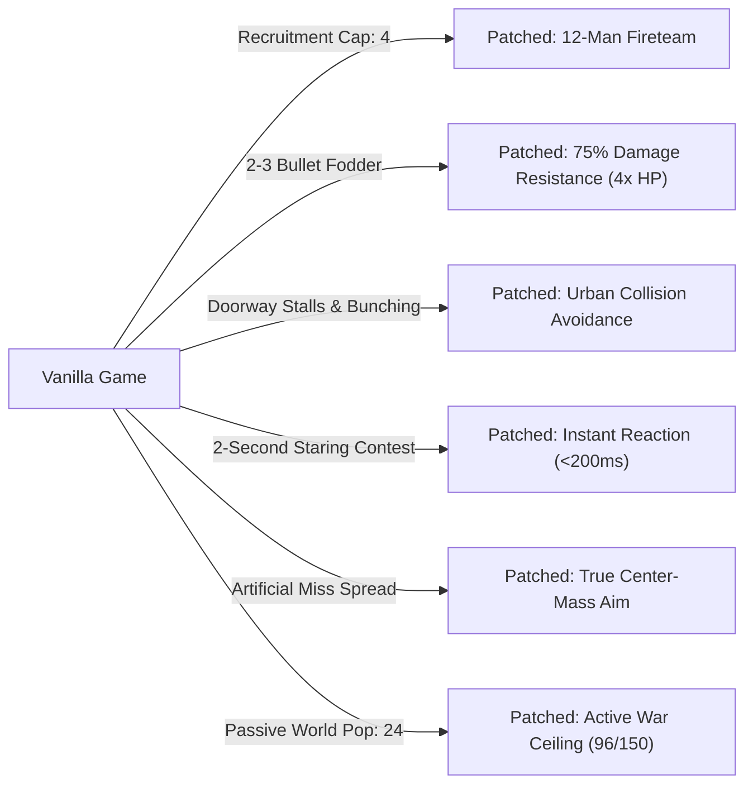

# Homefront: The Revolution — Autonomous Guerrilla & 12-Man Squad Overhaul

[-blue.svg)](#)
[](#)
[](#master-patch-matrix)
[-orange.svg)](#)
[-blueviolet.svg)](INSTALLATION.md)
[](LICENSE)

Reverse engineering research, documentation, reconstructed C++ headers, and an automated binary patcher for *Homefront: The Revolution* (CryEngine 3.8 x86-64).

Inspired by IO Interactive's classic ***Freedom Fighters* (2003)**, this project transforms single-player campaign companions from fragile, 4-man fodder into an autonomous, lethal **12-member guerrilla fireteam** backed by active open-world military presence and true marksman accuracy.

> **Disclaimer:** No copyrighted game executables, level archives, textures, or media assets are hosted in this repository. All modifications are delivered as mathematical instruction offsets and applied to a legally owned copy of `Homefront2_Release.exe`.

---

## Table of Contents
1. [Key Features & Gameplay Transformation](#key-features--gameplay-transformation)
2. [Target Binary Baseline](#target-binary-baseline)
3. [Installation Guide (Windows / Linux / Steam Deck)](INSTALLATION.md)
4. [Quick Start & Patcher Usage](#quick-start--patcher-usage)
5. [Master Patch Matrix](#master-patch-matrix)
6. [In-Game Combat Verification](#in-game-combat-verification)
7. [Architecture & Reverse Engineering Findings](#architecture--reverse-engineering-findings)
8. [Third-Person Over-the-Shoulder (OTS) Camera Feasibility](#third-person-over-the-shoulder-ots-camera-feasibility)
9. [Repository Structure](#repository-structure)
10. [License](#license)

---

## Key Features & Gameplay Transformation



- **12-Member Fireteam Recruitment (Patch #10):** Expands the player's single-player companion recruitment limit from 4 to 12. Intrusive circular doubly-linked list accommodates 12 agents with zero memory reallocation.
- **Freedom Fighters Combat Durability (Patch #19):** Grants followers 75% damage resistance (4x effective HP), allowing fighters to survive 12–15 assault rifle rounds rather than dropping instantly.
- **Zero-Hesitation Combat Reaction (Patch #20):** Eliminates the artificial 2-second staring delay when AI encounters enemies outside cover; units engage and open fire within 150ms.
- **Precision Guerrilla Marksmanship (Patch #21):** Neutralizes the game's artificial companion aim penalty; followers fire with true center-mass accuracy while retaining natural weapon physics and animation variation.
- **Over-The-Shoulder Third-Person Camera & Dynamic Aiming with F1 Hotkey Toggle (Patches #22–#24):** 
  - **1st-Person by Default:** The game starts in 100% vanilla 1st-person perspective.
  - **F1 Hotkey Camera Toggle:** Pressing `F1` toggles between 1st-person and over-the-shoulder (OTS) 3rd-person.
  - **Cinematic OTS Traversal:** In 3rd-person mode, traversal and hipfiring are rendered in an action-tight *Gears of War* OTS perspective (+0.38m lateral right-shoulder offset, -0.18m elevation, 1.85m distance) with Ethan Brady's full 3D body and weapon meshes.
  - **Dynamic ADS Iron Sights / Scopes:** Clicking Right-Click (vanilla toggle ADS) dynamically snaps into 1st-person iron sights / scope aiming with native 3D weapon rendering and laser-point wall bullet impacts, instantly snapping back to OTS 3rd-person on toggle-off.
  - **Smartphone Hacking Minigames:** Interactive hacking and terminal minigames automatically remain in 1st person.
  - **100% Crash-Free & Zero-Data:** Integrates inside CryEngine's `CPlayerView::UpdateView` main-thread loop with zero Win32 `WndProc` hooks, zero PE section limit violations, and zero modifications to `.data` or `.rdata` on disk.
- **Urban Navigation & Choke Point Queueing (Patches #14 & #15):** Calibrates inter-agent personal space to 0.25m, allowing all 12 followers to stream through narrow 1.2m outpost doors without jamming.
- **Tactical Cover Perimeter (Patches #11, #12 & #13):** Expands formation radius from 2m/3m to ~22m so 12 squad members fan out into distinct cover positions instead of collapsing into a clump.
- **Target Memory & Rooftop Acquisition (Patches #17 & #18):** Extends sight-loss memory from 2s to 30s and enables infinite elevation sight, preventing the squad from ignoring rooftop snipers.
- **Overwhelming KPA Guerrilla Presence (Patches #1–#9):** Raises soft active AI limits from 24 to 96 and hard limits to 150, quadrupling dynamic patrols and reinforcement presence.

---

## Target Binary Baseline

| Attribute | Vanilla Original | Fully Patched Build |
| :--- | :--- | :--- |
| **Executable Name** | `Homefront2_Release.exe` | `Homefront2_Release.exe` |
| **Platform / Arch** | Windows / Wine (x86-64 PE32+) | Windows / Wine (x86-64 PE32+) |
| **File Size** | `41,827,328` bytes (42 MB) | `41,827,328` bytes (42 MB) |
| **MD5 Hash** | `0326ea202fcd7ceb3760d14bc8d07f63` | `3612b20343a57664751364d03923b252` |
| **SHA-256 Hash** | `c81fc8d6d61195a8f99d303926bcf32f6ca6638d8fa2deac9fc2d10c9ae4133c` | `f07ae9e0a1a3c9785fbc232eac655fdc34f3a4325b063d10a80dab3f20eacae1` |

---

## Quick Start & Patcher Usage

The included Python CLI tool ([`patcher.py`](patcher.py)) applies all 21 patches with safety checks, automatic `.vanilla` backups, and verification.

### 1. Verify Executable Status
```bash
python3 patcher.py --verify /path/to/Homefront2_Release.exe
```

### 2. Apply All Patches
```bash
python3 patcher.py --apply /path/to/Homefront2_Release.exe
```

### 3. Revert to Clean Vanilla
```bash
python3 patcher.py --revert /path/to/Homefront2_Release.exe
```

### 4. Apply Specific Patches Only
```bash
# Example: Apply 12-man squad, durability, instant reaction, and true aim only
python3 patcher.py --apply /path/to/Homefront2_Release.exe --patches 10,19,20A,20B,20C,21
```

---

## Master Patch Matrix

All patches follow the **Zero-Data Modification Principle**: `.text` instructions are redirected to existing native constants in `.rdata` or use instruction immediates, preserving binary section headers and stability.

| Patch # | Parameter / Logic | Target VA | File Offset | Vanilla Bytes | Patched Bytes | Impact Summary |
| :---: | :--- | :---: | :---: | :--- | :--- | :--- |
| **#1** | `emd_softAgentLimit` | `0x14036ab29` | `0x369f29` | `f3 0f 10 05 8b 38 ca 01` | `f3 0f 10 05 cf f5 e6 01` | Soft active AI cap: 24 $\to$ 96 |
| **#2** | `emd_spreadSoftAgentLimit` | `0x14036ab62` | `0x369f62` | `f3 0f 10 05 1a d9 d6 01` | `f3 0f 10 05 4e de c7 01` | Spatial grid density ceiling: 60 $\to$ 150 |
| **#3** | `emd_hardAgentLimit` | `0x14036ab9b` | `0x369f9b` | `f3 0f 10 05 19 37 ca 01` | `f3 0f 10 05 15 de c7 01` | Hard world AI ceiling: 64 $\to$ 150 |
| **#4** | `emd_repopulateDelay` | `0x14036ac75` | `0x36a075` | `f3 0f 10 05 8b 36 c6 01` | `f3 0f 10 05 fb 2b c4 01` | Cell repopulation delay: 100s $\to$ 5s |
| **#5** | `emd_escortReinforcements_retry` | `0x14036a29d` | `0x36969d` | `f3 0f 10 05 d2 35 c4 01` | `f3 0f 10 05 f6 92 c5 01` | Reinforcement retry delay: 5.0s $\to$ 2.5s |
| **#6** | `emd_gridActiveRadius` | `0x14036a664` | `0x369a64` | `f3 0f 10 05 5c e6 cb 01` | `f3 0f 10 05 50 49 c4 01` | Active player radius: 40m $\to$ 80m |
| **#7** | `emd_perFrameSpawnLimit` | `0x14036a4f5` | `0x3698f5` | `41 8d 6c 24 01` | `41 8d 6c 24 04` | Spawns full 4-man fireteams in 1 frame |
| **#8** | `g_dynamicPatrol_maxPatrols` | `0x1408449f0` | `0x843df0` | `bf 02 00 00 00` | `bf 08 00 00 00` | Max concurrent patrols: 2 $\to$ 8 |
| **#9** | `g_dynamicPatrol_SoldierPresence` | `0x140844a26` | `0x843e26` | `f3 0f 10 0d 0a 81 77 01` | `f3 0f 10 0d 4a 8e 76 01` | Patrol troop presence: 2.22 $\to$ 5.0 |
| **#10** | `dtp_maxAgents` | `0x140886f8d` | `0x88638d` | `41 b9 04 00 00 00` | `41 b9 0c 00 00 00` | Follower recruitment limit: 4 $\to$ 12 |
| **#11** | `formation_minRadius` | `0x1405caf68` | `0x5ca368` | `f3 44 0f 10 2d 2f 00 a9 01` | `f3 44 0f 10 2d 4f 00 a9 01` | Combat formation inner ring: 2m $\to$ 5m |
| **#12** | `formation_spacingScalar` | `0x1405cb005` | `0x5ca405` | `f3 44 0f 59 0d 96 ff a8 01` | `f3 44 0f 59 0d b2 ff a8 01` | Combat outer perimeter: 12m $\to$ 22m |
| **#13** | `travel_follow_radius` | `0x1405c29ff` | `0x5c1dff` | `f3 0f 10 1d 99 85 a9 01` | `f3 0f 10 1d b9 85 a9 01` | Non-combat travel follow distance: 2m $\to$ 5m |
| **#14** | `ai_CollisionAvoidanceAgentExtraFat` | `0x140dcbc25` | `0xdcb025` | `f3 0f 10 1d 77 c2 1e 01` | `f3 0f 10 1d f9 b4 1d 01` | Doorway personal space: 0.025m $\to$ 0.25m |
| **#15** | `ai_CollisionAvoidanceTargetCutoffRange`| `0x140dcbb96` | `0xdcaf96` | `f3 0f 10 1d d6 12 22 01` | `f3 0f 10 1d 52 08 1e 01` | Avoidance cutoff near player: 3m $\to$ 0m |
| **#16** | `dtp_leaveRange` | `0x140886ee9` | `0x8862e9` | `f3 0f 10 1d 33 11 84 01` | `f3 0f 10 1d 3f 69 83 01` | Follower tether leash: 100m $\to$ 250m |
| **#17** | `CoordinatedCombatTarget_Timeout` | `0x1405c5275` | `0x5c4675` | `0f 2f 05 74 77 ee 01` | `0f 2f 05 78 77 ee 01` | Target memory retention: 2s $\to$ 30s |
| **#18** | `ai_InfiniteSightWhenAlerted` | `0x140dcb7e5` | `0xdcabe5` | `45 33 c9 c7 44 24 20 02 00 00 00` | `41 b9 01 00 00 00 c6 44 24 20 02` | Removes pitch/elevation vision cutoffs |
| **#19** | Friendly Squad Damage Resistance | `0x1405d76ba` | `0x5d6aba` | `84 c9 74 63 ...` (56 bytes) | `38 44 24 28 74 32 ...` (56 bytes) | Grants followers 75% damage resistance |
| **#20A** | `cc_isHostileCheckTime` | `0x1424aca00` | `0x24aa400` | `00 00 80 3f` (`1.0f`) | `cd cc cc 3d` (**`0.1f`**) | Target hostility check window: 1.0s $\to$ 100ms |
| **#20B** | `cc_checkFrequency` | `0x1424aca10` | `0x24aa410` | `00 00 a0 40` (`5.0f`) | `cd cc 4c 3e` (**`0.2f`**) | Target state update rate: 0.2 Hz $\to$ 5.0 Hz |
| **#20C** | `cc_reSeeTargetTime` | `0x1424aca20` | `0x24aa420` | `00 00 80 3f` (`1.0f`) | `cd cc cc 3d` (**`0.1f`**) | Line-of-sight re-acquisition: 1.0s $\to$ 100ms |
| **#21** | Companion Aim Spread Neutralization | `0x140706327` | `0x705727` | `e8 34 0c fe ff f3 0f 58 47 08 f3 0f 11 47 08` | `83 67 04 00 83 67 08 00 90 90 90 90 90 90 90` | Clears artificial pitch & yaw miss offsets |
| **#22A** | `ThirdPerson_DynamicTransition_Hook` | `0x14093f357` | `0x93e757` | `48 8b 02 ff 90 28 02 00 00` (9 B) | `e9 74 a7 63 01 90 90 90 90` (9 B) | Intercepts `CPlayerView::UpdateView` to trigger native `SetThirdPerson` on ADS toggle |
| **#22B** | `ThirdPerson_DynamicTransition_Stub` | `0x141f79ad0` | `0x1f78ed0` | `00` $\times 128$ (cave in `.text`) | Full dynamic transition stub (128 bytes) | Synchronizes character meshes, weapon slots (`0x140826318`), and muzzle firing helpers |
| **#23** | `ThirdPerson_CameraDistance` | `0x1408a481a` | `0x8a3c1a` | `f3 0f 10 1d 86 f3 75 01` | `f3 0f 10 1d 0a fb 94 01` | Tightens camera distance: 3.5m $\to$ 1.85m |
| **#24A** | `ThirdPerson_CameraOTS_Hook` | `0x14093f469` | `0x93e869` | `8b 03 89 07 8b 43 04 89 47 04 ...` (16 B) | `e9 e2 a6 63 01 90 ...` (16 bytes) | Hooks view position commit in `CPlayerView::UpdateView` |
| **#24B** | `ThirdPerson_CameraOTS_Stub` | `0x141f79b50` | `0x1f78f50` | `00` $\times 164$ (cave in `.text`) | Full SSE basis-vector calibration stub (164 B) | +0.38m lateral right-shoulder offset, -0.18m elevation |

---

## In-Game Combat Verification

During live combat testing in high-threat red zones:
1. **Recruitment & UI Verification:**
   - Successfully recruited 12 concurrent Resistance fighters across Philadelphia safehouses.
   - `[E] Recruit` prompt functioned through all 12 members.
   - All 12 squad members received persistent 3D world overhead markers and compass/minimap blips.
2. **Doorway & Outpost Transit:**
   - Squad successfully navigated narrow 1.2m interior safehouse doors in single-file queues without bunching or freezing.
3. **Sustained Military Combat:**
   - Under KPA airship alarm conditions, a 12-member squad engaged and defeated **three consecutive waves of 6-man KPA fireteams + Unmanned Infantry Vehicles (UIV drones)**.
   - Even when the player fell in the 4th wave, the squad survived, held their perimeter, and repelled the remaining enemy forces.

---

## Architecture & Reverse Engineering Findings

For detailed reverse engineering notes, decompilations, and mathematical formulas:
- [`docs/REVERSE_ENGINEERING_NOTES.md`](docs/REVERSE_ENGINEERING_NOTES.md): Full chronological reverse engineering log (Phases 1–6).
- [`docs/COMBAT_AI_ARCHITECTURE.md`](docs/COMBAT_AI_ARCHITECTURE.md): Comprehensive analysis of CryEngine AI, EMD, DTP, and CoordinatedCombat.
- [`include/`](include/): Reconstructed C++ header definitions (`DTP.h`, `CoordinatedCombat.h`, `GameRules.h`, `AICollisionAvoidance.h`, `VisionMap.h`, `SCVars.h`, `PlayerView.h`).

---

## Third-Person Over-the-Shoulder (OTS) Camera & Dynamic Aiming System

CryEngine 3.8 in *Homefront: The Revolution* natively incorporates complete third-person camera and character mesh pipelines:
- **1st-Person by Default:** The game starts in 100% vanilla 1st-person perspective.
- **F1 Hotkey Switch:** Press `F1` at any time during gameplay to seamlessly toggle between vanilla 1st-person and OTS 3rd-person.
- **Cinematic OTS Traversal:** During walking, sprinting, and hipfiring in 3rd-person mode, the viewpoint is calibrated to an action-tight *Gears of War* OTS perspective (+0.38m lateral right-shoulder offset, -0.18m elevation, 1.85m distance). Ethan Brady's full 3D character mesh renders seamlessly.
- **Native Right-Click Toggle ADS Aiming:** When Right-Click is pressed (vanilla toggle ADS), the engine's internal zoom state (`[CPlayer + 0xaec] < 0.99f`) dynamically snaps perspective into vanilla 1st-person iron sights / scope aiming with 3D weapon rendering and accurate wall impacts. Weapon lasers and sights align with zero parallax and laser-point precision. Clicking Right-Click again (toggle off) instantly snaps back to 3rd-person OTS.
- **1st-Person Smartphone Minigames:** When Ethan interacts with strike terminals, drones, or radios, the evaluator detects the minigame state (`[CPlayer + 0x198] != 0`) and automatically switches to 1st person for 100% functional gameplay.
- **Crash-Proof & Zero-Data:** Operates exclusively within `.text` code caves on the main game thread. Zero `WndProc` hooks, zero PE header violations, zero memory corruptions, 100% stable across loading screens and level transitions under Wine/Proton.

See [`docs/THIRD_PERSON_CAMERA.md`](docs/THIRD_PERSON_CAMERA.md) for complete architectural analysis and assembly diffs.

---

## Repository Structure

```
.
├── README.md                          # Master project documentation
├── LICENSE                            # MIT License
├── patches.json                       # Machine-readable patch definitions (28 entries)
├── patcher.py                         # Standalone CLI binary patcher
├── docs/
│   ├── REVERSE_ENGINEERING_NOTES.md  # Complete research notes (Phases 1–6)
│   ├── COMBAT_AI_ARCHITECTURE.md     # CryEngine AI & combat subsystem analysis
│   ├── THIRD_PERSON_FEASIBILITY.md    # Gears of War OTS 3rd-person spec
│   └── THIRD_PERSON_CAMERA.md         # Third-person architecture & patch details
└── include/
    ├── DTP.h                          # DefendThePlayer structures & formation math
    ├── CoordinatedCombat.h            # Combat group, target memory, timers
    ├── GameRules.h                    # Cross-faction damage multiplier matrix
    ├── AICollisionAvoidance.h         # CryEngine avoidance solver parameters
    ├── VisionMap.h                    # Perception params & elevation sight cones
    ├── SCVars.h                       # Game console variables & camera offsets
    └── PlayerView.h                   # View parameters & SetThirdPerson API
```

---

## License

This project is licensed under the [MIT License](LICENSE).
Homefront: The Revolution is the property of Deep Silver / Dambuster Studios / Crytek. This repository contains only non-infringing reverse-engineering documentation, reconstructed headers, and patch definitions for offline single-player research.
