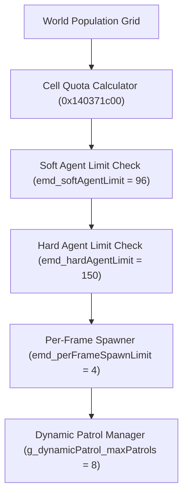

# CryEngine 3.8 Combat AI Architecture in Homefront: The Revolution

This document details the underlying engine architecture of *Homefront: The Revolution* (CryEngine 3.8 x86-64), reconstructed during reverse engineering to transform companion fireteams into an autonomous, 12-member squad inspired by *Freedom Fighters* (2003).

---

## 1. Population & Dynamic Encounter Pipeline (`EMD`)

The game governs open-world guerrilla warfare and KPA military presence via the **Emergent Manager Dynamic (EMD)** subsystem:

### Key Parameters Reversed:
- **`emd_softAgentLimit` (`0x14036ab29`):** Soft active AI ceiling. Vanilla defaulted to `24.0f`. Increased to `96.0f` (4x) to maintain dense civilian, guerrilla, and KPA firefights simultaneously.
- **`emd_hardAgentLimit` (`0x14036ab9b`):** Hard safety ceiling. Vanilla defaulted to `64.0f`. Increased to `150.0f` to prevent despawning active combatants during heavy multi-fireteam skirmishes.
- **`emd_perFrameSpawnLimit` (`0x14036a4f5`):** Rate at which new entities are spawned. Vanilla clamped this to 1 per frame, staggering reinforcements. Patched to 4 to instantiate coherent military squads in one frame.

---

## 2. Squad Recruitment Subsystem: DefendThePlayer (`DTP`)

Single-player companion recruitment is handled by the **DefendThePlayer (DTP)** engine component.

### Intrusive Doubly-Linked List Topology:
Unlike many games that allocate fixed arrays (e.g. `EntityId followers[4]`), CryEngine stores companions in an intrusive circular doubly-linked list:
- Head pointer: `[player + 0x80]`
- Tail pointer: `[player + 0x88]`
- Active count: `[player + 0x90]` (`int32_t`)
- Node pointers: embedded inside each NPC's entity component at `[npc + 0x18]` and `[npc + 0x20]`.

Because no fixed-stride memory allocation exists, raising the squad limit requires **no heap resizing or struct expansion**. The recruitment checks:
- `CanRecruit` (`0x1406e5ce1`)
- `CanToggleRecruit` (`0x1406e5ed3`)
- `SetupPlayerDTP` (`0x1406fffe5`)

All dynamically query `[gEnv + 0x90c]` (`dtp_maxAgents`). Modifying `dtp_maxAgents` from 4 to 12 updates the entire recruitment pipeline cleanly.

---

## 3. Squad Formation Geometry

Follower positions around the player are calculated dynamically in `FUN_1405ca308`:

$$\text{rings} = \left\lfloor \frac{\text{numUnits} - 1}{7} \right\rfloor + 1$$

$$\text{maxRadius} = \sqrt{\text{numUnits}} \cdot \text{spacingScalar} + \text{minRadius}$$

$$\text{ringRadius} = \text{ringIndex} \cdot \left(\frac{\text{maxRadius} - \text{minRadius}}{\text{rings} + 1}\right) + \text{minRadius}$$

In vanilla:
- `minRadius` = `2.0m`, `spacingScalar` = `3.0f`
- With 12 followers, units collapsed into a congested 2-to-12 meter cluster that clogged doorways and blocked player movement.
- **Patched (Patches #11 & #12):** `minRadius` = `5.0m`, `spacingScalar` = `5.0f`. Expands perimeter to ~22 meters, allowing 12 fighters to fan out into distinct cover locations.

---

## 4. Collision Avoidance & Urban Navigation

CryEngine uses a predictive steering collision avoidance solver:
- **`ai_CollisionAvoidanceAgentExtraFat` (`0x140dcbc25`):** Buffer added to the physical cylinder radius.
  - Vanilla: `0.025m` (2.5 cm) $\to$ followers bumped into each other.
  - Attempted: `1.0m` (100 cm) $\to$ created a 2.6m avoidance bubble that blocked narrow 1.2m outpost doors.
  - **Patched (Patch #14):** `0.25m` (25 cm) $\to$ perfect balance for smooth queueing through doorways while fanning out across streets.
- **`ai_CollisionAvoidanceTargetCutoffRange` (`0x140dcbb96`):**
  - Vanilla disabled avoidance within 3 meters of the player (`3.0m`), causing agents to walk directly into the player upon halting.
  - **Patched (Patch #15):** Set to `0.0m` (always active).

---

## 5. Combat Hesitation Elimination & Target Memory

When AI encounters enemies outside cover:
1. **Target Verification Latency:**
   - `cc_checkFrequency` (`0x1424aca10`): Target state evaluation throttled to once every 5.0 seconds. Patched to `0.2s` (5 Hz).
   - `cc_isHostileCheckTime` (`0x1424aca00`): Delays engagement by 1.0s to verify weapon drawn state. Patched to `0.1s`.
   - `cc_reSeeTargetTime` (`0x1424aca20`): Re-acquisition verification delay. Patched from 1.0s to `0.1s`.
   - *Result:* Eliminates the 2-second awkward staring contest; AI engages within 150ms.
2. **Target Retention Timeout (`0x1405c5275`):**
   - Vanilla dropped enemies who ducked behind cover for 2.0 seconds (`cc_abandonTargetTime = 2.0s`), causing squad members to forget rooftop snipers.
   - **Patched (Patch #17):** Extended to `30.0s`.

---

## 6. Squad Durability & Marksmanship

### Damage Mitigation (Patch #19):
- In `CGameRules::GetDamageMultiplier` (`0x1405d76ba`), companions received 100% unmitigated damage, dying in 2–3 assault rifle bullets.
- Patched with native Zero-Data redirection to apply a `0.25f` multiplier to companions (75% damage resistance), giving them 4x effective health to withstand heavy firefights.

### Precision Marksmanship (Patch #21):
- In `0x140706327`, the engine deliberately added an extra miss error to companion aim (`call 0x1406e6f60; addss xmm0, [rdi+8]`) so small vanilla squads wouldn't steal kills.
- Patched by zeroing out the artificial pitch & yaw offsets (`and dword ptr [rdi+4], 0; and dword ptr [rdi+8], 0`), allowing Resistance squad members to hit center-mass reliably while retaining natural weapon physics and animation variation.
