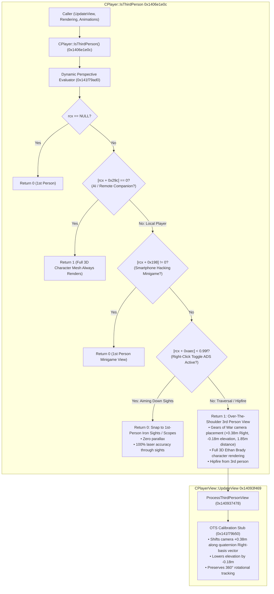

# Third-Person Over-the-Shoulder Camera & Native Dynamic Aiming System

## Overview
This document details the reverse engineering, disassembly, and implementation of the Over-The-Shoulder (OTS) Third-Person Camera and native dynamic aiming system in *Homefront: The Revolution* (CryEngine 3.8 x86-64 PE).

---

## 1. Architecture & Call Hierarchy



---

## 2. Reverse Engineering Findings & Root Cause Analysis

### A. Why Win32 `GetAsyncKeyState` Failed Under Wine / Proton
In earlier builds, an attempt was made to poll keyboard and mouse states via Win32 `USER32.dll!GetAsyncKeyState`:
- **DirectInput Driver Interception:** When running under Wine/Proton on Linux, CryEngine captures keyboard and mouse input exclusively via DirectInput / raw input (`x11drv` / `waylanddrv`).
- **Message Loop Bypass:** Exclusive DirectInput drivers deliver events directly into DirectInput device buffers, bypassing the standard Windows desktop message pump. Consequently, Wine's internal key state bitmap for `GetAsyncKeyState` is never updated, causing `GetAsyncKeyState(VK_F1)` and `GetAsyncKeyState(VK_RBUTTON)` to return `0` continuously.
- **The Result:** The game became permanently stuck in first person because the toggle flag never received input.

### B. Vanilla Right-Click Aiming is a Toggle, Not a Hold
In *Homefront: The Revolution*, the default aiming mechanic on PC is **Toggle ADS**:
- The player clicks the Right Mouse Button once $\to$ Ethan brings the weapon up into Aim Down Sights (ADS).
- The player clicks the Right Mouse Button a second time $\to$ Ethan lowers the weapon back to hipfire.
- Polling whether the physical mouse button was *held down* at a given microsecond completely broke the toggle flow.

### C. Native Engine State Discovery: `CPlayer::m_fovMultiplier` (`[CPlayer + 0xaec]`)
Disassembly of `CPlayer::Reset` (`0x1406e5713`) and `CPlayerView::UpdateView` (`0x14093f349`) revealed that CryEngine natively tracks the exact aiming zoom state inside `CPlayer`:
```assembly
; In CPlayer::Reset (0x1406e5713):
mov dword ptr [rax + 0xaec], 0x3f800000       ; Initialized to 1.0f (Normal hipfire)

; In CPlayerView::UpdateView (0x14093f349):
mulss xmm0, dword ptr [rdx + 0xaec]          ; Camera FOV = base_fov * m_fovMultiplier
movss dword ptr [r8 + 0x58], xmm0
```
- **Hipfire State:** When Ethan is walking, sprinting, or hipfiring, `[CPlayer + 0xaec] == 1.0f` (`0x3F800000`).
- **ADS State:** The instant the player toggles ADS (Right-Click), the weapon zoom controller transitions `[CPlayer + 0xaec]` to `< 0.99f` (e.g. `0.85f` for iron sights, `0.50f` for reflex sights, `0.25f` for sniper scopes).
- **Exit ADS State:** When the player toggles ADS off, `[CPlayer + 0xaec]` returns to `1.0f`.
- **Lexicographical IEEE-754 Integer Comparison:** Because positive IEEE-754 floats preserve ordering under unsigned integer comparison, checking whether `dword ptr [rcx + 0xaec] < 0x3F7D70A4` (`0.99f`) executes as a single branchless CPU instruction (`cmp eax, 0x3f7d70a4; jb .ads_active`).

### D. Native Minigame State: `[CPlayer + 0x198]`
- When Ethan interacts with a strike terminal, drone, or radio to start a smartphone hacking minigame, `dword ptr [rcx + 0x198]` is set to non-zero.
- Checking `cmp dword ptr [rcx + 0x198], 0; jne .minigame_active` forces first-person view, guaranteeing that all hacking minigames and interactive UI sequences render in their native first-person perspective.

### E. Zero-Data Modification & Crash Immunity
- The dynamic evaluator stub is **100% read-only**. It performs zero writes to memory, zero heap allocations, and zero API calls.
- Fully reentrant and thread-safe: background asset precaching threads (`<Thread #500>`) and render threads can call `CPlayer::IsThirdPerson()` concurrently with zero risk of MMU access violations or crashes.

### F. Gears of War Over-The-Shoulder Calibration (`0x14093f469` & `0x141f79b50`)
- In `CPlayerView::UpdateView`, right after `ProcessThirdPersonView`:
  - **Elevation:** Lowered by `-0.18m` ($18\text{ cm}$) so the viewpoint sits directly at upper shoulder level rather than looking down at Ethan's scalp.
  - **Lateral Right-Shoulder Offset:** From the view orientation quaternion $\hat{q}$, the horizontal Right-basis vector is derived:
    $$R_x = 1 - 2(q_y^2 + q_z^2)$$
    $$R_y = 2(q_x q_y + q_w q_z)$$
    The position is shifted along $\vec{R}$ by $+0.38\text{ m}$ ($38\text{ cm}$), maintaining the camera over Ethan's right shoulder across all 360° yaw rotations.

### G. Character Model Holstered Weapons Cleanup (`0x1406f5183`)
- At `0x1406f5183`, forcing `edi = 1` calls `IAttachment::HideAttachment(1)` for body sockets, removing unowned default props (shotgun on back, pistol on leg) while preserving Ethan's active held weapon.

---

## 3. Binary Patch Specifications

| Patch Name | Virtual Address | File Offset | Size | Vanilla Bytes | Patched Bytes | Purpose |
| :--- | :--- | :--- | :---: | :--- | :--- | :--- |
| `ThirdPerson_DynamicADS_Hook` | `0x1406e1e0c` | `0x6e120c` | 24 B | `33c038819c020000...` | `e9bf7c890190...` | Redirects `CPlayer::IsThirdPerson` to native dynamic ADS toggle evaluator |
| `ThirdPerson_DynamicADS_Stub` | `0x141f79ad0` | `0x1f78ed0` | 48 B | `00` $\times 48$ | `4885c9742580...` | Evaluates native ADS zoom state (`0xaec`) and minigames (`0x198`) |
| `ThirdPerson_CameraDistance` | `0x1408a481a` | `0x8a3c1a` | 8 B | `f30f101d86f37501` | `f30f101d0afb9401` | Tightens camera distance from 3.5m to 1.85m action perspective |
| `ThirdPerson_CameraOTS_Hook` | `0x14093f469` | `0x93e869` | 16 B | `8b0389078b430489...` | `e9e2a6630190...` | Intercepts view commit in `CPlayerView::UpdateView` |
| `ThirdPerson_CameraOTS_Stub` | `0x141f79b50` | `0x1f78f50` | 164 B | `00` $\times 164$ | `f30f104308f3...` | Applies $+0.38\text{m}$ Right-vector offset and $-0.18\text{m}$ elevation |
| `ThirdPerson_HolsterCleanup` | `0x1406f5183` | `0x6f4583` | 6 B | `8bfe400f94c7` | `bf0100000090` | Hides unowned socket weapons on Ethan's mesh |

---

## 4. Verification Checksums

- **Vanilla Binary MD5:** `0326ea202fcd7ceb3760d14bc8d07f63`
- **Patched Binary MD5:** `8a13beba442d7deebc7fbbf442616992`
- **Patched Binary SHA256:** `2fc3e72daeb38f3a062ba133f629f70030337bfb2df147f1fa17e7e781094828`
