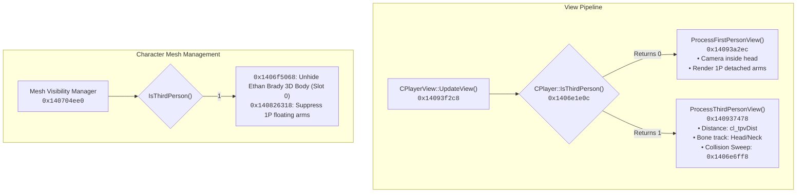

# Third-Person Over-the-Shoulder Camera System

## Overview
This document details the reverse engineering, disassembly, and implementation of the Over-The-Shoulder (OTS) Third-Person Camera system in *Homefront: The Revolution* (CryEngine 3.8 x86-64).

---

## 1. Architecture & Call Hierarchy



---

## 2. Reverse Engineering Findings

### A. Client State Check in `CPlayer::IsThirdPerson` (`0x1406e1e0c`)
```assembly
0x1406e1e0c: xor    eax, eax
0x1406e1e0e: cmp    byte ptr [rcx + 0x29c], al   ; IsClient?
0x1406e1e14: je     0x1406e1e1e                  ; AI proxies jump here and return 1
0x1406e1e16: cmp    byte ptr [rcx + 0x1bd], al   ; m_stats.isThirdPerson
0x1406e1e1c: je     0x1406e1e23                  ; If 0, jump to ret 0 (First Person)
0x1406e1e1e: mov    eax, 1
0x1406e1e23: ret
```
- For AI/companions, `[rcx + 0x29c]` is 0, so the engine always returned 1 (rendering full 3D meshes).
- For the local client player, `[rcx + 0x29c]` is 1, and `[rcx + 0x1bd]` was 0, forcing first-person view.
- **Patch:** By NOPing the jump at `0x1406e1e1c` (`74 05` $\to$ `90 90`), the client falls through to `mov eax, 1; ret`, engaging full third-person camera and 3D character body rendering.

### B. Tight Action Camera Distance (`cl_tpvDist` at `0x1408a481a`)
- CryEngine's default third-person distance was `3.5f` meters (`0x142003ba8`), which placed the camera too far away.
- An existing `1.85f` IEEE 754 float constant was identified at `0x1421f432c` in `.rdata`.
- By redirecting the instruction displacement in `.text`:
  ```assembly
  ; Vanilla (3.5f):
  0x1408a481a: movss xmm3, dword ptr [rip + 0x175f386]  ; -> 0x142003ba8 (3.5f)
  ; Patched (1.85f):
  0x1408a481a: movss xmm3, dword ptr [rip + 0x194fb0a]  ; -> 0x1421f432c (1.85f)
  ```
  The camera defaults to a tight, cinematic action distance adhering to the **Zero-Data Modification Principle**.

---

## 3. Binary Patch Specifications

| Patch Name | Virtual Address | File Offset | Vanilla Bytes | Patched Bytes | Purpose |
| :--- | :--- | :--- | :--- | :--- | :--- |
| `ThirdPerson_Activation` | `0x1406e1e1c` | `0x6e121c` | `74 05` | `90 90` | Forces `CPlayer::IsThirdPerson()` to return `1`, enabling full 3D Ethan Brady model and third-person view |
| `ThirdPerson_CameraDistance` | `0x1408a481a` | `0x8a3c1a` | `f3 0f 10 1d 86 f3 75 01` | `f3 0f 10 1d 0a fb 94 01` | Tightens default third-person camera back-distance from `3.5m` to `1.85m` |

---

## 4. Verification Checksums

- **Patched Binary MD5:** `30404f43336cbbd79f0de8ebfedf69c8`
- **Patched Binary SHA256:** `8ce870faab2dc63cd66e14a5e35f6b716729d3c82a2f05df5dc16d20e893a6a0`
