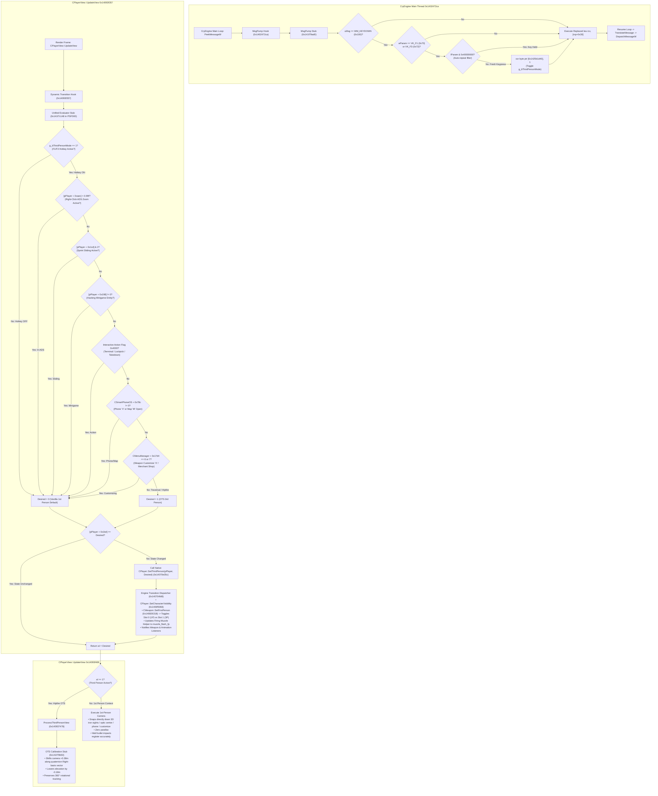

# Third-Person Over-the-Shoulder Camera & Native Dynamic Aiming System

## Overview
This document details the reverse engineering, disassembly, and implementation of the Over-The-Shoulder (OTS) Third-Person Camera, Win32 Message Pump Hotkey Toggle, and unified dynamic perspective transitions in *Homefront: The Revolution* (CryEngine 3.8 x86-64 PE).

---

## 1. Architecture & Call Hierarchy



---

## 2. Reverse Engineering Findings & Root Cause Analysis

### A. Root Cause of Missing 1P Weapon Model & Invisible Bullet Impacts
In earlier dynamic perspective builds, `CPlayer::IsThirdPerson()` (`0x1406e1e0c`) was hooked directly to evaluate `[CPlayer + 0xaec] < 0.99f`. While this successfully shifted the camera to first person during ADS, it produced two critical bugs:
1. **Weapon 3D Model Disappeared:** In CryEngine, weapons maintain separate geometry slots:
   - `eIGS_FirstPerson` (`Slot 0`): First-person animated weapon mesh and optics, attached to 1st-person arms.
   - `eIGS_ThirdPerson` (`Slot 1`): Third-person weapon model, attached to Ethan's 3rd-person body hand socket (`Bip01 R Hand`).
   Merely changing the return value of `IsThirdPerson()` in the camera calculation never called the weapon switch dispatcher (`0x140826318`), leaving `Slot 0` uninitialized and dormant.
2. **Invisible Bullet Impacts:** In weapon firing (`0x140411da0`), the engine verifies whether `IsThirdPerson()` is active. When it saw `0`, it called `IActor::GetCharacter(0)` (`0x140411f8c`) to query the weapon attachment in character slot 0. Because slot 0 was never equipped, the attachment pointer returned `NULL` (`0x140411fc4`), jumping to `0x140412995` which aborted the shot. **No bullet was ever spawned, no raycast was performed, and no bullet impact appeared on the wall.**

### B. Discovery of Native Engine Switch Method: `CPlayer::SetThirdPerson` (`0x14070e35c`)
Binary disassembly revealed that CryEngine already possesses an official, thread-safe function to transition a player between 1st person and 3rd person:
```assembly
; CPlayer::SetThirdPerson(CPlayer* this, bool bThirdPerson) at 0x14070e35c:
0x14070e35c: mov [rsp + 8], rbx
0x14070e361: push rdi
0x14070e362: sub rsp, 0x20
0x14070e366: mov rdi, rcx
0x14070e369: cmp byte ptr [rcx + 0x1bd], dl   ; Check if [CPlayer + 0x1bd] == dl
0x14070e36f: je 0x14070e3b5                  ; If already in target state, return immediately!
0x14070e371: mov byte ptr [rcx + 0x1bd], dl  ; Update internal state flag
0x14070e377: call 0x140704fd8                 ; Call engine transition dispatcher!
0x14070e37c: cmp qword ptr [rdi + 0x1078], 0
...                                          ; Notifies weapon and animation listeners
0x14070e3bf: ret
```

When `CPlayer::SetThirdPerson(pPlayer, 0)` is invoked on entering ADS or in-game 1P actions:
- It calls `0x140704fd8` $\to$ `0x140704ee0`.
- It executes `0x1406f5068` with `dl = 0` to configure 1st-person character arms and meshes.
- It calls `0x140826318` on the equipped weapon (`CWeapon*`) with `dl = 1`:
  - Activates `Slot 0` (1st-person weapon model, iron sights, optics).
  - Updates the firing muzzle helper to `muzzle_flash_fp`.
- Firing raycasts find the weapon attachment in slot 0, bullet trajectories register directly along the iron sightline, and bullet impacts appear on the targeted wall.

When `CPlayer::SetThirdPerson(pPlayer, 1)` is invoked on returning to OTS 3P:
- It calls `0x140826318` with `dl = 0`:
  - Activates `Slot 1` (3rd-person weapon model attached to Ethan's hands).
- Restores 3rd-person full body rendering.
- Camera returns to the calibrated OTS position (+0.38m Right, -0.18m elevation, 1.85m distance).

### C. Direct Wine/Proton Input Isolation vs Win32 Message Pump Hooking
- Under Wine/Proton and XWayland on Linux, `USER32.dll!GetAsyncKeyState` fails when called from CryEngine's secondary **Render Thread** (`CPlayerView::UpdateView`) because secondary threads lack window focus.
- Polling in earlier stubs failed or caused timing issues.
- **The Solution:** Intercept the main CryEngine Win32 message pump right after `PeekMessageW(&msg, NULL, 0, 0, PM_REMOVE)` at `0x1402472ca`. On the **Main Thread**, every keyboard message (`WM_KEYDOWN`, `0x100`) is cleanly captured. When `VK_F1` (`0x70`) or `VK_F3` (`0x72`) arrives with bit 30 of `lParam` unset (filtering out key hold autorepeats), the stub atomically toggles `g_bThirdPersonMode` at VA `0x1425b1d40`.
- This zero-overhead hook performs zero API calls, executes in nanoseconds, and never desynchronizes.

### D. In-Game Contextual 1st-Person Actions
Certain in-game interactions in *Homefront: The Revolution* are hardcoded for first-person rendering. The unified dynamic evaluator at `0x141f7c148` natively detects them:
1. **Weapon Customization (X key):** Modular on-the-fly weapon customization inspects `gEnv` (`0x14262eaf8`) $\to$ `CMenuManager* [rax + 0x1d0]` $\to$ `[rax + 0x17d4]`. When menu ID is 6 (`WeaponCustomization`) or 7 (`MerchantShop`), it forces 1st person so attachments and modular barrel/optic conversions are fully visible.
2. **Sprint-Sliding (Ctrl while sprinting):** Native 3P Ethan mesh lacks a standalone 3P sliding animation. The evaluator reads `[CPlayer + 0x1cd] & 2` (sliding state bit 9 of `[CPlayer + 0x1cc]`). When sliding begins, it drops to 1st person, plays the complete camera sliding animation, and seamlessly snaps back to 3P upon completion.
3. **Smartphone (V key) & Map (M key):** Detected through `g_pGameFramework` (`0x14262ebf8`) $\to$ `CSmartPhoneOS* [rax + 0x420]` $\to$ `[rax + 0x78c] != 0`.
4. **Hacking Minigames & Terminal Interactions:** Strike terminals, lockpicking, and drone control are detected via `[CPlayer + 0x198] != 0` or interactive action flag `0x4000` at `[[[CPlayer + 0x1040] + 0x20] + 8]`.

---

## 3. Dynamic Transition Hook & Stub Specification

### A. Message Pump Hook (`0x1402472ca`, Patch #25A, 5 Bytes)
```assembly
; In CryEngine Win32 Main Loop at 0x1402472ca:
0x1402472ca: jmp 0x141f79ad0              ; Jump to ThirdPerson_MsgPump_Stub
```

### B. Message Pump Stub (`0x141f79ad0`, Patch #25B, 128 Bytes in `.text`)
```assembly
0x141f79ad0: cmp dword ptr [rsp + 0x38], 0x100 ; WM_KEYDOWN?
0x141f79ad8: jne .orig
0x141f79ada: cmp dword ptr [rsp + 0x40], 0x70  ; VK_F1?
0x141f79adf: je .check_repeat
0x141f79ae1: cmp dword ptr [rsp + 0x40], 0x72  ; VK_F3?
0x141f79ae6: jne .orig
.check_repeat:
0x141f79ae8: test byte ptr [rsp + 0x4b], 0x40  ; Bit 30 of lParam (repeat flag)
0x141f79aed: jne .orig                         ; Ignore auto-repeats
0x141f79aef: xor byte ptr [rip + 0x63824a], 1  ; Toggle g_bThirdPersonMode at 0x1425b1d40
.orig:
0x141f79af6: lea rcx, [rsp + 0x30]             ; Original instruction
0x141f79afb: jmp 0x1402472cf                   ; Jump back to TranslateMessage
```

### C. Dynamic Transition Hook (`0x14093f357`, Patch #22A, 9 Bytes)
Replaces `mov rax, [rdx]; call [rax + 0x228]` with a direct jump to the unified evaluator stub in `PSFD00`:
```assembly
0x14093f357: jmp 0x141f7c148
0x14093f35c: nop
0x14093f35d: nop
0x14093f35e: nop
0x14093f35f: nop
```

### D. Unified Perspective Evaluator Stub (`0x141f7c148`, Patch #22B, 180 Bytes in `PSFD00`)
```assembly
0x141f7c148: xor ebx, ebx                      ; Desired = 0 (1st person default)
0x141f7c14a: cmp byte ptr [rip + 0x635bef], 1  ; g_bThirdPersonMode at 0x1425b1d40
0x141f7c151: jne .apply                        ; If hotkey mode is 0 -> force 1st person

0x141f7c157: mov eax, dword ptr [rdx + 0xaec]  ; Check ADS zoom FOV multiplier
0x141f7c15d: cmp eax, 0x3f7d70a4               ; 0.99f threshold
0x141f7c162: jb .apply                         ; ADS engaged -> force 1st person

0x141f7c164: test byte ptr [rdx + 0x1cd], 2    ; Check sprint sliding flag
0x141f7c16b: jne .apply                        ; Sliding -> force 1st person

0x141f7c16d: cmp dword ptr [rdx + 0x198], 0    ; Check hacking minigame entity
0x141f7c174: jne .apply                        ; Minigame active -> force 1st person

0x141f7c176: mov rax, qword ptr [rdx + 0x1040] ; Check interactive action flag
0x141f7c17d: test rax, rax
0x141f7c180: jz .check_phone
0x141f7c182: mov rax, qword ptr [rax + 0x20]
0x141f7c186: test rax, rax
0x141f7c189: jz .check_phone
0x141f7c18b: test dword ptr [rax + 8], 0x4000  ; Interactive action bit 14
0x141f7c193: jne .apply                        ; Terminal / lockpick -> force 1st person

.check_phone:
0x141f7c195: mov rax, qword ptr [rip + 0x6b2a5d] ; g_pGameFramework (0x14262ebf8)
0x141f7c19c: test rax, rax
0x141f7c19f: jz .check_menu
0x141f7c1a1: mov rax, qword ptr [rax + 0x420]    ; CSmartPhoneOS*
0x141f7c1a8: test rax, rax
0x141f7c1ab: jz .check_menu
0x141f7c1ad: cmp dword ptr [rax + 0x78c], 0      ; Phone/Map active
0x141f7c1b4: jne .apply                        ; Phone/Map open -> force 1st person

.check_menu:
0x141f7c1b6: mov rax, qword ptr [rip + 0x6b293c] ; gEnv (0x14262eaf8)
0x141f7c1bd: test rax, rax
0x141f7c1c0: jz .enable_tp
0x141f7c1c2: mov rax, qword ptr [rax + 0x1d0]    ; CMenuManager*
0x141f7c1c9: test rax, rax
0x141f7c1cc: jz .enable_tp
0x141f7c1ce: mov al, byte ptr [rax + 0x17d4]     ; Active menu ID
0x141f7c1d4: and al, 0xfe
0x141f7c1d6: cmp al, 6                           ; Menu 6 (Customize) or 7 (Shop)
0x141f7c1d8: je .apply

.enable_tp:
0x141f7c1da: mov bl, 1                           ; OTS 3rd person!

.apply:
0x141f7c1dc: cmp byte ptr [rdx + 0x1bd], bl      ; Check if state changed
0x141f7c1e2: je .done                            ; No change -> skip call
0x141f7c1e4: sub rsp, 0x28                       ; 16-byte aligned stack frame
0x141f7c1e8: mov dl, bl                          ; dl = desired
0x141f7c1ea: mov rcx, r12                        ; rcx = pPlayer
0x141f7c1ed: call 0x14070e35c                    ; Native CPlayer::SetThirdPerson!
0x141f7c1f2: add rsp, 0x28

.done:
0x141f7c1f6: mov al, bl                          ; Return value al = desired
0x141f7c1f8: jmp 0x14093f360                     ; Resume CPlayerView::UpdateView
```

---

## 4. Active Binary Patch Table (30 Patches Total)

| Patch Name | Virtual Address | File Offset | Size | Purpose |
| :--- | :--- | :--- | :---: | :--- |
| `ThirdPerson_DynamicTransition_Hook` (#22A) | `0x14093f357` | `0x93e757` | 9 B | Intercepts `CPlayerView::UpdateView` to jump to unified evaluator |
| `ThirdPerson_DynamicTransition_Stub` (#22B) | `0x141f7c148` | `0x1f7b148` | 180 B | Evaluates F1/F3 mode, ADS zoom, sliding, weapon customize, phone/map, minigames |
| `ThirdPerson_CameraDistance` (#23) | `0x1408a481a` | `0x8a3c1a` | 8 B | Tightens camera distance from 3.5m to 1.85m action perspective |
| `ThirdPerson_CameraOTS_Hook` (#24A) | `0x14093f469` | `0x93e869` | 16 B | Intercepts view commit in `CPlayerView::UpdateView` |
| `ThirdPerson_CameraOTS_Stub` (#24B) | `0x141f79b50` | `0x1f78f50` | 164 B | Applies $+0.38\text{m}$ Right-vector offset and $-0.18\text{m}$ elevation (*Gears of War* OTS) |
| `ThirdPerson_MsgPump_Hook` (#25A) | `0x1402472ca` | `0x2466ca` | 5 B | Hooks main CryEngine Win32 message pump right after `PeekMessageW` |
| `ThirdPerson_MsgPump_Stub` (#25B) | `0x141f79ad0` | `0x1f78ed0` | 128 B | Atomic F1/F3 hotkey toggle stub in `.text` (toggles `g_bThirdPersonMode` at `0x1425b1d40`) |

---

## 5. Verification Checksums

- **Vanilla Binary MD5:** `0326ea202fcd7ceb3760d14bc8d07f63`
- **Vanilla Binary SHA256:** `c81fc8d6d61195a8f99d303926bcf32f6ca6638d8fa2deac9fc2d10c9ae4133c`
- **Fully Patched Binary MD5:** `b536426f8ae27559e2eb861596111e47`
- **Fully Patched Binary SHA256:** `96e4771ed73827114f2db97a9f109ab93ca50aa20147e43e3c5f61eae067a0f2`
