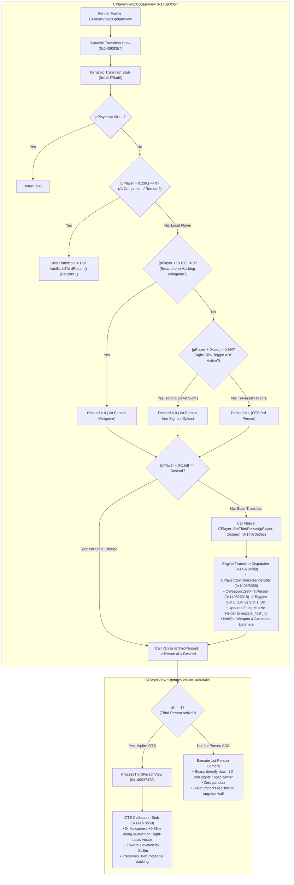

# Third-Person Over-the-Shoulder Camera & Native Dynamic Aiming System

## Overview
This document details the reverse engineering, disassembly, and implementation of the Over-The-Shoulder (OTS) Third-Person Camera and native dynamic aiming system in *Homefront: The Revolution* (CryEngine 3.8 x86-64 PE).

---

## 1. Architecture & Call Hierarchy



---

## 2. Reverse Engineering Findings & Root Cause Analysis

### A. Root Cause of Missing 1P Weapon Model & Invisible Bullet Impacts
In earlier dynamic perspective builds, `CPlayer::IsThirdPerson()` (`0x1406e1e0c`) was hooked directly to evaluate `[CPlayer + 0xaec] < 0.99f`. While this successfully shifted the camera to first person during ADS, it produced two critical bugs:
1. **Weapon 3D Model Disappeared:** In CryEngine, weapons maintain separate geometry slots:
   - `eIGS_FirstPerson` (`Slot 0`): First-person animated weapon mesh and optics, attached to 1st-person arms.
   - `eIGS_ThirdPerson` (`Slot 1`): Third-person weapon model, attached to Ethan's 3rd-person body hand socket (`Bip01 R Hand`).
   Merely changing the return value of `IsThirdPerson()` in the camera calculation never called the weapon switch dispatcher (`0x140826318`), leaving `Slot 0` uninitialized and dormant.
2. **Invisible Bullet Impacts:** In weapon firing (`0x140411da0`), the engine verifies whether `IsThirdPerson()` is active. When it saw `0`, it called `IActor::GetCharacter(0)` (`0x140411f8c`) to query the weapon attachment in character slot 0. Because slot 0 was never equipped, the attachment pointer returned `NULL` (`0x140411fc4`), jumping to `0x140412995` which aborted the shot. **No bullet was ever spawned, no raycast was performed, and no bullet impact appeared on the wall.**
3. **Attachment Cleanup Overreach (`Patch 25`):** The previous holster cleanup patch at `0x1406f5183` forced `edi = 1`, causing `IAttachment::HideAttachment(1)` to be called unconditionally across all attachments, hiding even the weapon Ethan held in his hands.

### B. Discovery of Native Engine Switch Method: `CPlayer::SetThirdPerson` (`0x14070e35c`)
Binary disassembly revealed that CryEngine already possesses an official, thread-safe function to transition a player between 1st person and 3rd person:
```assembly
; CPlayer::SetThirdPerson(CPlayer* this, bool bThirdPerson) at 0x14070e35c:
0x14070e35c: mov [rsp + 8], rbx
0x14070e361: push rdi
0x14070e362: sub rsp, 0x20
0x14070e366: mov rdi, rcx
0x14070e369: cmp byte ptr [rcx + 0x1bd], dl   ; Check if [CPlayer + 0x1bd] == dl
0x14070e36f: je 0x14070e3b5                  ; If already in target state, return immediately!
0x14070e371: mov byte ptr [rcx + 0x1bd], dl  ; Update internal state flag
0x14070e377: call 0x140704fd8                 ; Call engine transition dispatcher!
0x14070e37c: cmp qword ptr [rdi + 0x1078], 0
...                                          ; Notifies weapon and animation listeners
0x14070e3bf: ret
```

When `CPlayer::SetThirdPerson(pPlayer, 0)` is invoked on entering ADS:
- It calls `0x140704fd8` $\to$ `0x140704ee0`.
- It executes `0x1406f5068` with `dl = 0` to configure 1st-person character arms and meshes.
- It calls `0x140826318` on the equipped weapon (`CWeapon*`) with `dl = 1`:
  - Calls `[pWeapon + 0x438]`, activating `Slot 0` (1st-person weapon model, iron sights, optics).
  - Updates the firing muzzle helper to `muzzle_flash_fp`.
- Firing raycasts find the weapon attachment in slot 0, bullet trajectories register directly along the iron sightline, and bullet impacts appear on the targeted wall.

When `CPlayer::SetThirdPerson(pPlayer, 1)` is invoked on exiting ADS:
- It calls `0x140826318` with `dl = 0`:
  - Calls `[pWeapon + 0x440]`, activating `Slot 1` (3rd-person weapon model attached to Ethan's hands).
- Restores 3rd-person full body rendering.
- Camera returns to the calibrated OTS position (+0.38m Right, -0.18m elevation, 1.85m distance).

### C. Direct Wine/Proton Input Isolation vs Native Engine State
- `USER32.dll!GetAsyncKeyState` fails under Proton/Wine on Linux because CryEngine captures input directly through DirectInput (`x11drv`), bypassing the desktop message pump.
- By intercepting `CPlayerView::UpdateView` (`0x14093f357`) and reading the engine's internal Zoom FOV multiplier `[CPlayer + 0xaec]`:
  - Traversal & Hipfire: `[CPlayer + 0xaec] == 1.0f` (`0x3F800000`).
  - Right-Click Toggle ADS Active: `[CPlayer + 0xaec] < 0.99f` (`0x3F7D70A4`).
  - Smartphone Hacking Minigame: `[CPlayer + 0x198] != 0`.
- Transitions execute instantly on the exact frame of the toggle with zero polling overhead.

---

## 3. Dynamic Transition Hook & Stub Specification

### A. UpdateView Intercept Hook (`0x14093f357`, 9 Bytes)
Replaces `mov rax, [rdx]; call [rax + 0x228]` with a direct jump to the transition stub:
```assembly
0x14093f357: jmp 0x141f79ad0
0x14093f35c: nop
0x14093f35d: nop
0x14093f35e: nop
0x14093f35f: nop
```

### B. Dynamic Transition Stub (`0x141f79ad0`, 128 Bytes)
```assembly
0x141f79ad0: test rdx, rdx
0x141f79ad3: je 0x141f79b4a               ; NULL check -> return 0
0x141f79ad5: cmp byte ptr [rdx + 0x29c], 0
0x141f79adc: je 0x141f79b38               ; AI companion -> skip transition, call vanilla IsThirdPerson()
0x141f79ade: xor eax, eax                 ; Desired default = 0 (1st person)
0x141f79ae0: cmp byte ptr [rip + 0x2086519], 0 ; Check g_thirdPersonEnabled at 0x144000000 (F1 toggle)
0x141f79ae7: je 0x141f79b02               ; F1 toggle off (0) -> keep desired = 0 (vanilla 1st person)
0x141f79ae9: cmp dword ptr [rdx + 0x198], 0
0x141f79af0: jne 0x141f79b02              ; Minigame active -> desired = 0
0x141f79af2: mov ecx, dword ptr [rdx + 0xaec]
0x141f79af8: cmp ecx, 0x3f7d70a4         ; 0.99f zoom threshold
0x141f79afe: jb 0x141f79b02               ; Zoom < 0.99f (in ADS) -> desired = 0
0x141f79b00: mov al, 1                    ; Traversal / Hipfire -> desired = 1 (3rd person OTS)
0x141f79b02: cmp byte ptr [rdx + 0x1bd], al
0x141f79b08: je 0x141f79b38               ; Current state == desired -> fast path skip!
0x141f79b0a: push r8
0x141f79b0c: push r9
0x141f79b0e: push r10
0x141f79b10: push r11
0x141f79b12: sub rsp, 0x30                ; 16-byte stack alignment + 32-byte shadow space
0x141f79b16: movdqu xmmword ptr [rsp + 0x20], xmm0 ; Preserve xmm0
0x141f79b1c: mov dl, al                   ; dl = desired (0 or 1)
0x141f79b1e: mov rcx, r12                 ; rcx = pPlayer
0x141f79b21: call 0x14070e35c             ; Native CPlayer::SetThirdPerson!
0x141f79b26: movdqu xmm0, xmmword ptr [rsp + 0x20]
0x141f79b2c: add rsp, 0x30
0x141f79b30: pop r11
0x141f79b32: pop r10
0x141f79b34: pop r9
0x141f79b36: pop r8
0x141f79b38: mov rcx, r12
0x141f79b3b: mov rax, qword ptr [r12]
0x141f79b3f: call qword ptr [rax + 0x228] ; Call vanilla CPlayer::IsThirdPerson()
0x141f79b45: jmp 0x14093f360              ; Resume CPlayerView::UpdateView
0x141f79b4a: xor eax, eax
0x141f79b4c: jmp 0x141f79b45
```

---

## 4. F1 Hotkey Perspective Switcher & Win32 WndProc Interception

### A. Architectural Concept
To reliably toggle perspective across Linux/Wine/Proton without polling broken Win32 key tables, the mod hooks the primary Win32 window procedure (`WndProc` at `0x1402494b8`).

### B. WndProc Hook (`0x1402494b8`, 15 Bytes)
```assembly
0x1402494b8: jmp 0x141f7c150              ; Jump to WndProc_F1_Stub
0x1402494bd: nop (x10)
```

### C. WndProc F1 Evaluation Stub (`0x141f7c150`, 59 Bytes)
```assembly
0x141f7c150: cmp edx, 0x100                   ; WM_KEYDOWN?
0x141f7c156: je 0x141f7c160
0x141f7c158: cmp edx, 0x104                   ; WM_SYSKEYDOWN?
0x141f7c15e: jne 0x141f7c177
0x141f7c160: cmp r8d, 0x70                    ; VK_F1?
0x141f7c164: jne 0x141f7c177
0x141f7c166: test r9d, 0x40000000             ; Bit 30: ignore autorepeat messages
0x141f7c16d: jne 0x141f7c177
0x141f7c16f: lock xor byte ptr [rip + 0x2083e89], 1  ; Atomically toggle [0x144000000] (0 <-> 1)
0x141f7c177: mov qword ptr [rsp + 8], rbx     ; Replaced original prologue
0x141f7c17c: mov qword ptr [rsp + 0x10], rbp
0x141f7c181: mov qword ptr [rsp + 0x18], rsi
0x141f7c186: jmp 0x1402494c7                  ; Return to WndProc (push rdi)
```

---

## 5. Active Binary Patch Table

| Patch Name | Virtual Address | File Offset | Size | Purpose |
| :--- | :--- | :--- | :---: | :--- |
| `ThirdPerson_DynamicTransition_Hook` | `0x14093f357` | `0x93e757` | 9 B | Intercepts `CPlayerView::UpdateView` to trigger native `SetThirdPerson` on ADS toggle and minigames |
| `ThirdPerson_DynamicTransition_Stub` | `0x141f79ad0` | `0x1f78ed0` | 128 B | Evaluates F1 hotkey toggle, ADS zoom, and minigames; triggers native mesh & weapon slot transitions |
| `ThirdPerson_CameraDistance` | `0x1408a481a` | `0x8a3c1a` | 8 B | Tightens camera distance from 3.5m to 1.85m action perspective |
| `ThirdPerson_CameraOTS_Hook` | `0x14093f469` | `0x93e869` | 16 B | Intercepts view commit in `CPlayerView::UpdateView` |
| `ThirdPerson_CameraOTS_Stub` | `0x141f79b50` | `0x1f78f50` | 164 B | Applies $+0.38\text{m}$ Right-vector offset and $-0.18\text{m}$ elevation (*Gears of War* OTS) |
| `WndProc_F1_Hook` | `0x1402494b8` | `0x2488b8` | 15 B | Intercepts Win32 `WndProc` message pump to detect physical F1 keydown messages without polling |
| `WndProc_F1_Stub` | `0x141f7c150` | `0x1f7b150` | 59 B | Evaluates `WM_KEYDOWN`/`WM_SYSKEYDOWN` for VK_F1, filters autorepeat, and toggles `g_thirdPersonEnabled` |

---

## 6. Verification Checksums

- **Vanilla Binary MD5:** `0326ea202fcd7ceb3760d14bc8d07f63`
- **Fully Patched Binary MD5:** `b18da28dc96c31fc73f6f4807a27b251`
- **Fully Patched Binary SHA256:** `867953c900199fb71686e2672d14da8774429133874261022d61a575887b9f56`
