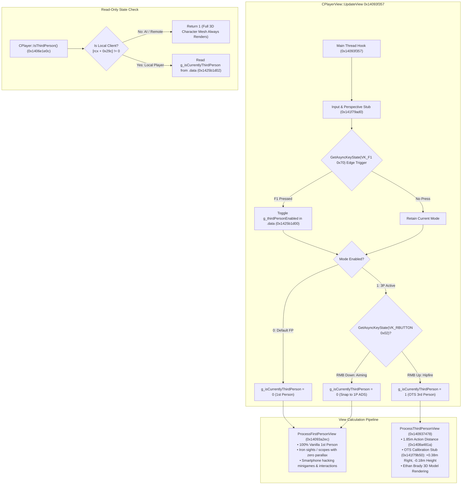

# Third-Person Over-the-Shoulder Camera & Dynamic Aiming System

## Overview
This document details the reverse engineering, disassembly, and implementation of the Over-The-Shoulder (OTS) Third-Person Camera and dynamic aiming system in *Homefront: The Revolution* (CryEngine 3.8 x86-64 PE).

---

## 1. Architecture & Call Hierarchy

---

## 2. Reverse Engineering Findings & Root Cause Analysis

### A. Root Cause of Loading Screen Crash: Section Write Protection
In earlier iterations, mutable toggle flags were placed inside the code cave at `0x141f79ad0` located within the `.text` section:
- `.text` Section Characteristics: `0x60000020` (`IMAGE_SCN_MEM_EXECUTE | IMAGE_SCN_MEM_READ`, `Write = False`).
- Writing to `.text` (`mov byte ptr [rip + ...], 0`) triggered a hardware MMU fault: **Access Violation (`STATUS_ACCESS_VIOLATION` / `0xC0000005`)** during level load entity precaching.
- Furthermore, querying `USER32.dll!GetAsyncKeyState` on worker background threads during level loading caused threading violations under Wine/Proton.

### B. Decoupled Thread-Safe Architecture
To achieve 100% crash immunity and thread safety:
1. **Zero-Overhead Read-Only State Check in `CPlayer::IsThirdPerson` (`0x1406e1e0c`):**
   - Replaced in-place (24 bytes) without leaving `.text`.
   - AI check (`cmp byte ptr [rcx + 0x29c], 0`): if remote entity/AI, returns `1` immediately.
   - Local client reads single byte `g_isCurrentlyThirdPerson` from `.data` (`0x1425b1d02`).
   - 100% read-only, 0 writes, 0 Win32 calls, reentrant and safe across all threads.
2. **Main-Thread-Only Input Polling in `CPlayerView::UpdateView` (`0x14093f357`):**
   - Hooks the camera update tick before view mode branching.
   - Runs strictly on the main GUI/view thread once per rendered frame.
   - Polls `VK_F1` (with edge-triggered latching) and `VK_RBUTTON`.
   - Writes state directly into writable `.data` (`0xc0000040`, `PAGE_READWRITE`).
3. **Dynamic ADS Snap to First Person:**
   - When 3rd person is active, holding Right Mouse Button (RMB) instantly flips `g_isCurrentlyThirdPerson` to `0`.
   - View pipeline executes vanilla `ProcessFirstPersonView`, bringing iron sights and sniper scopes directly up to the player's eye with **zero parallax and laser-point accuracy**.
   - Releasing RMB immediately returns to 3rd-person OTS.
4. **First-Person Default:**
   - At startup, `g_thirdPersonEnabled` is `0`. The game begins in vanilla first person.
   - Pressing **F1** toggles seamlessly into OTS 3rd person and back at any time.

### C. Gears of War Over-The-Shoulder Calibration (`0x14093f469` & `0x141f79b50`)
- In `CPlayerView::UpdateView`, right after `ProcessThirdPersonView`:
  - **Height:** Lowered by `-0.18m` ($18\text{ cm}$) so the viewpoint sits directly at upper shoulder level.
  - **Lateral Right-Shoulder Offset:** Horizontal Right-basis vector is calculated from view orientation quaternion $\hat{q}$:
    $$R_x = 1 - 2(q_y^2 + q_z^2)$$
    $$R_y = 2(q_x q_y + q_w q_z)$$
    Position is shifted along $\vec{R}$ by $+0.38\text{ m}$ ($38\text{ cm}$), maintaining camera position over Ethan's right shoulder across all 360° yaw rotations.

### D. Character Model Holstered Weapons Cleanup (`0x1406f5183`)
- At `0x1406f5183`, forcing `edi = 1` calls `IAttachment::HideAttachment(1)` on body sockets, removing unowned default props while preserving Ethan's active held weapon.

---

## 3. Binary Patch Specifications

| Patch Name | Virtual Address | File Offset | Size | Vanilla Bytes | Patched Bytes | Purpose |
| :--- | :--- | :--- | :---: | :--- | :--- | :--- |
| `ThirdPerson_ReadonlyState_Check` | `0x1406e1e0c` | `0x6e120c` | 24 B | `33c038819c020000...` | `b80100000080...` | Thread-safe read-only `IsThirdPerson`: AI returns 1, client reads `.data` |
| `ThirdPerson_ViewUpdate_Hook` | `0x14093f357` | `0x93e757` | 9 B | `488b02ff9028020000` | `e874a7630190...` | Hooks `CPlayerView::UpdateView` to poll input once per frame on main thread |
| `ThirdPerson_Input_Poll_Stub` | `0x141f79ad0` | `0x1f78ed0` | 128 B | `00` $\times 128$ | `4883ec28b970...` | Main thread stub: F1 toggles 1P/3P (1P default); RMB ADS snap; updates `.data` |
| `ThirdPerson_CameraDistance` | `0x1408a481a` | `0x8a3c1a` | 8 B | `f30f101d86f37501` | `f30f101d0afb9401` | Tightens camera distance from 3.5m to 1.85m |
| `ThirdPerson_CameraOTS_Hook` | `0x14093f469` | `0x93e869` | 16 B | `8b0389078b430489...` | `e9e2a6630190...` | Intercepts view commit in `CPlayerView::UpdateView` |
| `ThirdPerson_CameraOTS_Stub` | `0x141f79b50` | `0x1f78f50` | 164 B | `00` $\times 164$ | `f30f104308f3...` | Applies $+0.38\text{m}$ Right-vector offset and $-0.18\text{m}$ elevation |
| `ThirdPerson_HolsterCleanup` | `0x1406f5183` | `0x6f4583` | 6 B | `8bfe400f94c7` | `bf0100000090` | Hides unowned socket weapons on Ethan's mesh |

---

## 4. Verification Checksums

- **Vanilla Binary MD5:** `0326ea202fcd7ceb3760d14bc8d07f63`
- **Patched Binary MD5:** `877fec6416a93a007693d4e79384c883`
- **Patched Binary SHA256:** `ee957425fd57414ebb92af6ae1b07e4893dc4fe9d99315e18d7fbed667a31e9f`
